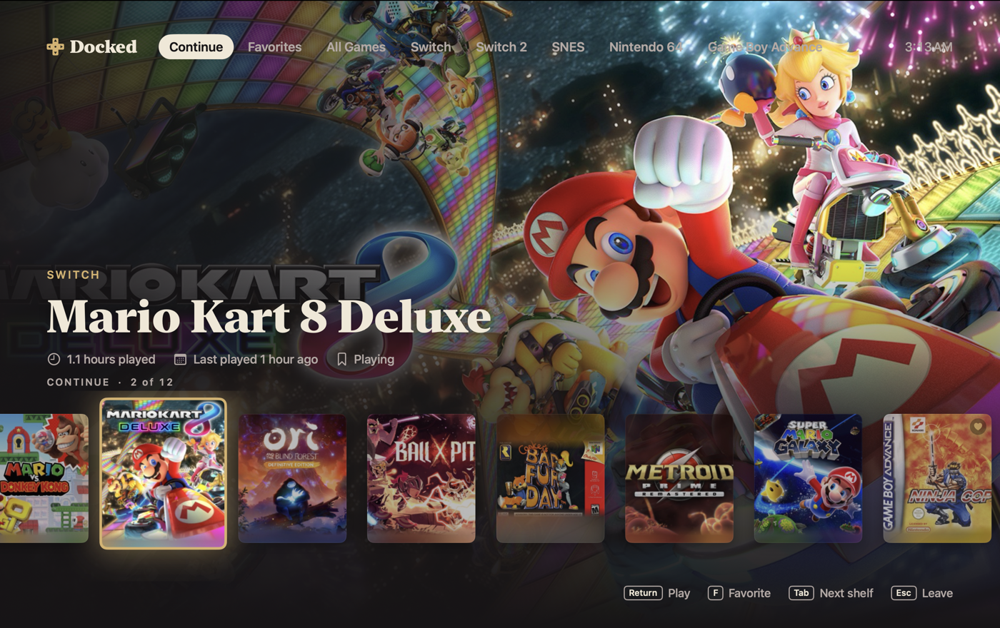

<b>Switch games become real Mac apps. Your old favourites sit right beside them.</b> 
One library, from NES to Switch. Free, open source, quick to open.

  <a href="https://github.com/Tyrus707/docked/releases/latest/download/Docked.dmg"><b>⬇ Download for Mac</b></a> · about 115 MB 
  macOS 13+ for retro games · macOS 26.6+ on Apple silicon for Switch

  
  
  

---

## Why you'll like it

**Your Switch games feel at home.** Docked turns each game into its own Mac app, so you launch it from the Dock like anything else. It sorts out updates and DLC, tells you if something's missing, and keeps your saves. No emulator window, no fiddling.

**Everything you already own, on one shelf.** NES, SNES, Game Boy, N64, GameCube, Wii, PlayStation, PS2, PSP, Dreamcast, Saturn and more. Drag a game in and Docked works out what it is. RetroArch installs itself the first time — you never have to open it.

**A library that gets out of the way.** Covers, play time, favourites and a quick "pick up where you left off". Light or dark mode, keyboard or controller, and Couch Mode when you're on the sofa.

## See it

  
   
  One shelf for everything · pick up where you left off

## Start playing

1. Download **Docked.dmg** and drag it to Applications. Upgrading? Choose **Replace** — your games and saves stay.
2. On first launch, macOS asks permission. Go to **System Settings › Privacy & Security › Open Anyway**. Just once.
3. Drop in a game. Switch games need one **Convert** press; retro games play straight away.

Prefer a zip? [Docked.zip](https://github.com/Tyrus707/docked/releases/latest/download/Docked.zip) works the same.

## What you need

| | |
|---|---|
| Library and retro games | macOS 13+, Intel or Apple chip |
| Switch games | macOS 26.6+, Apple chip |
| Converting Switch games | Plus [Xcode 27.2](https://developer.apple.com/download/all/) |

## No accounts, no fuss

Docked has no sign-in and collects nothing. It checks for updates when it opens (you can turn that off) and fetches RetroArch or cover art only when you ask. Your games, keys and system files stay on your Mac. Bring games from your own console, where local law allows.

Need a hand? [Open an issue](https://github.com/Tyrus707/docked/issues/new) with your macOS version, your Mac's chip and a **Copy Report** — give it a quick read first, and never post games or keys.

Docked is free under the [MIT licence](LICENSE). It wouldn't exist without [nxnative](https://github.com/seedds/nxnative). Console names belong to their owners; Docked isn't affiliated with Nintendo or anyone else. [Credits](THIRD-PARTY.md).
