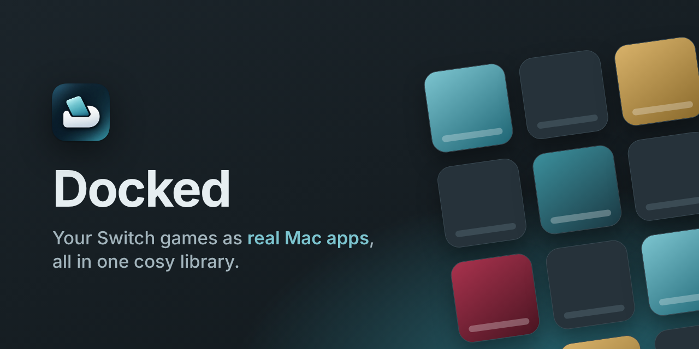
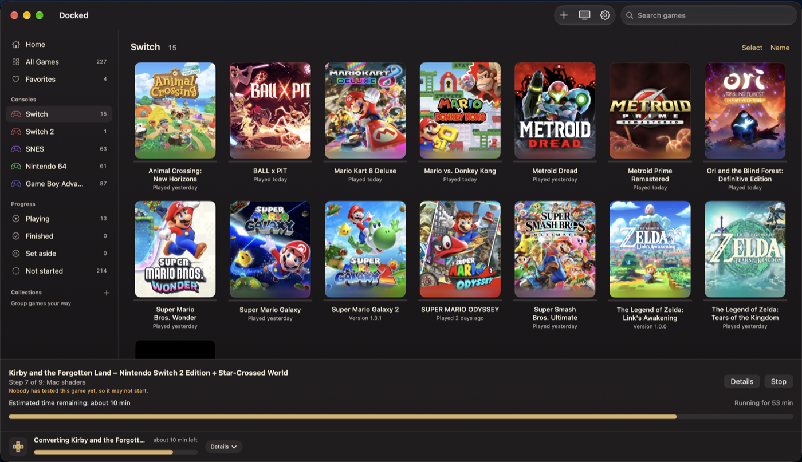

<b>Switch games become real Mac apps. Your old favourites sit right beside them.</b> 
One library, from NES to Switch. Free, open source, quick to open.

  <a href="https://github.com/Tyrus707/docked/releases/latest/download/Docked.dmg"><b>⬇ Download for Mac</b></a> · about 115 MB 
  macOS 13+ for retro games · macOS 26.6+ on Apple silicon for Switch

  
  
  

---

## Why you'll like it

**Your Switch games feel at home.** Docked turns each game into its own Mac app — native, not emulated — so games run beautifully and look even better. Launch it from the Dock like anything else. It sorts out updates and DLC, tells you if something's missing, and keeps your saves. No emulator window, no fiddling.

**Everything you already own, on one shelf.** NES, SNES, Game Boy, N64, GameCube, Wii, PlayStation, PS2, PSP, Dreamcast, Saturn and more. Drag a game in and Docked works out what it is. RetroArch installs itself the first time — you never have to open it.

**A cozy library that gets out of the way.** Covers, play time, favourites, sorting and a quick "pick up where you left off". Keep games on your Mac or an external SSD; unplug it and they wait for you. Pick a theme, play with keyboard or controller, and switch on Couch Mode when you're on the sofa.

**Your library on the big screen.** Turn on Streaming in Settings › TV and Docked quietly sets up Sunshine. Install Moonlight on your TV, iPad or another Mac, pick this Mac and type the PIN. Your games and Couch Mode appear there, with your covers and play time. Pair a controller with this Mac by Bluetooth for the quickest input.

**Super Mario Maker 2 courses, without leaving the game.** In a converted game's **Saves › Course Browser** (or the **File** menu), Docked starts the game with a small, private browser page and presses **F6** there to show it inside the game window — no floating panel. Search by name or ID, choose a course, and see a real thumbnail when the public course server answers; otherwise the preview is drawn from that course's own level data, and if neither exists the page says so. Put the course into an existing Downloaded Course slot, or queue it while you play: Docked writes it after you save and quit, checking again that the game is closed. It backs up the save first and changes only that course file — no sign-in, no Nintendo connection, nothing uploaded. The game keeps the slot's old thumbnail, title, maker and play stats, because those live in separate files. The reversible engine hook is dormant unless Docked starts that session; see [CourseBrowser/README.md](CourseBrowser/README.md) for how it works and how to remove it.

## See it

  
   
  One shelf for everything · pick up where you left off

## Start playing

1. Download **Docked.dmg** and drag it to Applications. Upgrading? Choose **Replace** — your games and saves stay.
2. On first launch, macOS asks permission. Go to **System Settings › Privacy & Security › Open Anyway**. Just once.
3. Drop in a game. Switch games need one **Convert** press; retro games play straight away.

## Play on any screen

In **Settings › TV**, switch Streaming on. Docked uses a signed Sunshine already on this Mac if there is one; otherwise it downloads the newest stable [Sunshine](https://github.com/SunshineStream/Sunshine) release, checks GitHub's checksum and signature, and keeps it in its own hidden folder — nothing is added to Applications or asked to run in Terminal. Streaming stays on your network; Docked does not open ports on your router. It uses VideoToolbox on this Mac, with HEVC where the TV supports it, H.264 as the fallback, and AV1 when the hardware can do it.

Install [Moonlight](https://moonlight-stream.org/) on your TV, iPad or another Mac. It finds this Mac on the same network. Choose the Mac, read out the four-digit PIN, and approve it in **Settings › TV**. Pick **Pixel-perfect**, **Balanced** or **Data saver** there. Ethernet or 5 GHz Wi-Fi gives the steadiest picture. Docked stops the stream when you quit, and restarts it up to three times if it ever stops unexpectedly.

Pair a controller with this Mac over Bluetooth rather than with the TV. Its input goes straight into the game, which connects better and has less delay than sending buttons over the network. This first version sends the picture from your Mac; system sound is still on the way. Sunshine is a separate open-source project under the GPL-3.0; Docked downloads it only when you ask and does not bundle it.

Prefer a zip? [Docked.zip](https://github.com/Tyrus707/docked/releases/latest/download/Docked.zip) works the same.

## What you need

| | |
|---|---|
| Library and retro games | macOS 13+, Intel or Apple chip |
| Switch games | macOS 26.6+, Apple chip |
| Converting Switch games | Plus [Xcode 27.2](https://developer.apple.com/download/all/) |

## No accounts, no fuss

Docked has no sign-in and collects nothing. It checks for updates when it opens (you can turn that off) and fetches RetroArch or cover art only when you ask. Your games, keys and system files stay on your Mac. Bring games from your own console, where local law allows.

Need a hand? [Open an issue](https://github.com/Tyrus707/docked/issues/new) with your macOS version, your Mac's chip and a **Report Problem** summary — give it a quick read first, and never post games or keys.

Docked is free under the [MIT licence](LICENSE). It wouldn't exist without [nxnative](https://github.com/seedds/nxnative). Console names belong to their owners; Docked isn't affiliated with Nintendo or anyone else. [Credits](THIRD-PARTY.md).
