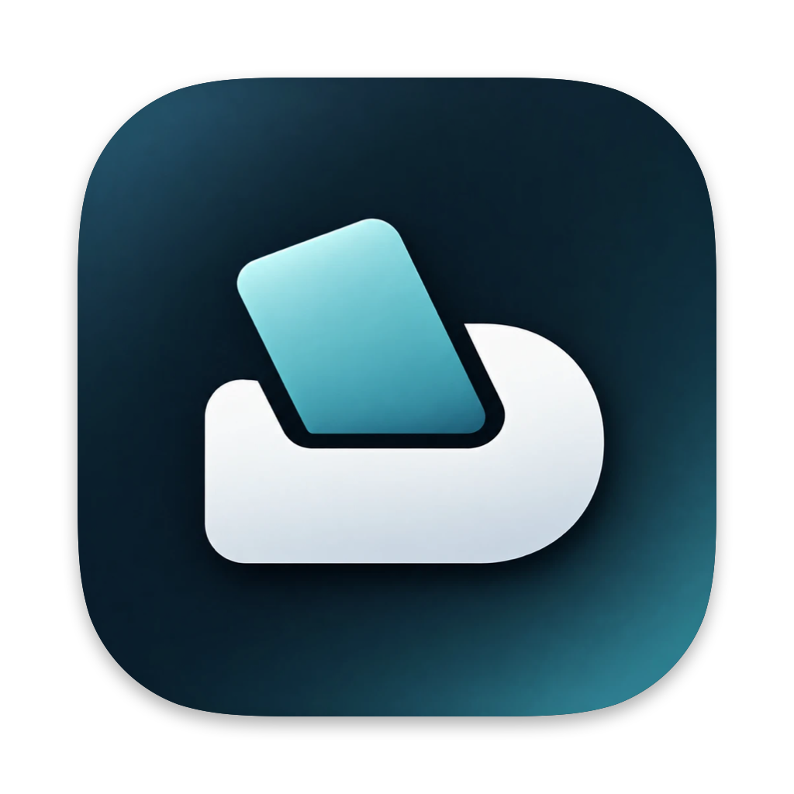

<p align="center"></p>

# Docked

A free, open-source game library for Mac. Docked turns Switch games you own into native Mac apps, and keeps them beside your games for other consoles.

- **Convert**: drop in a game you dumped yourself, add its update and DLC, and press Convert. The work is done by [nxnative](https://github.com/seedds/nxnative).
- **Play**: one library for converted games and for other consoles, which run in [RetroArch](https://www.retroarch.com) if you have it.
- **Organise**: favourites, collections, play time, and games saved where you choose.

No games, keys, firmware or console files are included, and none may be posted here.

## What you need

| | Needs |
|---|---|
| Library and other consoles | macOS 13 or later, Apple or Intel |
| Playing converted games | macOS 26.6 or later, Apple chip |
| Converting games | macOS 26.6 or later, Apple chip, [Xcode 27.2](https://developer.apple.com/download/all/) |

Docked has been tested on macOS 27.2. Older versions and Intel are built for but not yet tested on real Macs. Games that use OpenGL may need macOS 27 to convert.

## Install

1. Download **Docked.zip** from [Releases](../../releases) and unzip it.
2. Move **Docked** to Applications and open it.
3. Docked is not notarised by Apple. If macOS blocks it, open **System Settings > Privacy & Security** and choose **Open Anyway**.
4. To convert games, follow the steps in Docked's Setup window. The conversion tools are inside the app; Xcode is not.

A converted game's graphics are prepared for the Mac that made it. On a different chip or major macOS version the first start is slower.

## Your games only

Use Docked only with games and system files from your own console, where your local law allows it. Docked needs your own `prod.keys` file for some file types. It stays on your Mac: Docked remembers where it is and never copies or sends it.

Docked is not affiliated with, endorsed by or connected to Nintendo or any other company. Console and game names belong to their owners and are used only to say what works with what.

## Build it yourself

```
./test.sh                       # tests (Xcode needed)
./build.sh Docked.app           # the app alone; setup.sh then installs the tools with Homebrew
./build.sh Docked.app tools.xz  # with the tools inside, made by Bundle/make.sh
```

`Bundle/make.sh` packs what `setup.sh` installed, with a pinned [standalone Python](https://github.com/astral-sh/python-build-standalone/releases/tag/20261124) placed in `~/Dockside/python-standalone`. Every pinned version and fingerprint is in those scripts.

## Help

Open an issue with your macOS version, your Mac's chip, and what Docked says under **Details**. Do not attach games, keys or logs that contain them.

## Licence and credits

Docked is under the [MIT licence](LICENSE). It would not exist without [nxnative](https://github.com/seedds/nxnative) by seedds (MIT). Everything else inside the download is listed in [THIRD-PARTY.md](THIRD-PARTY.md).
